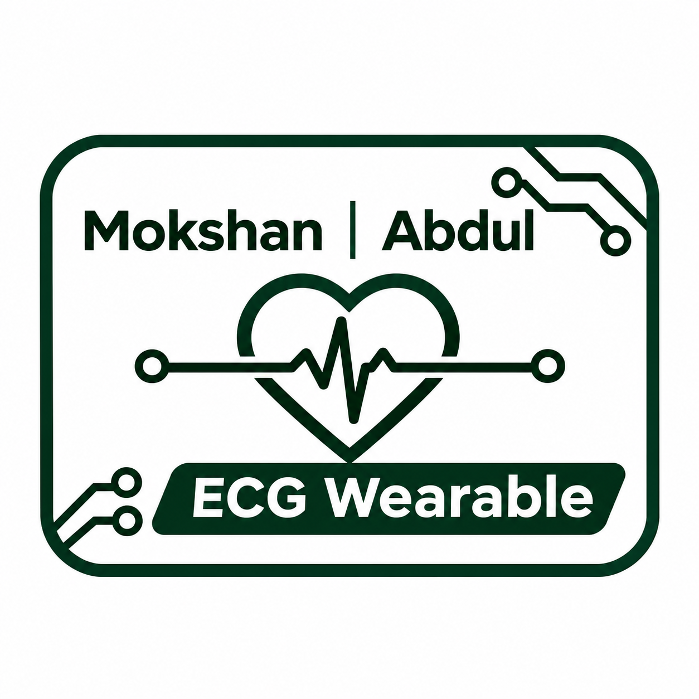
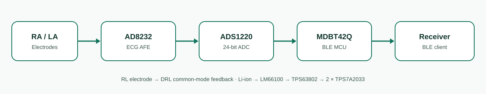
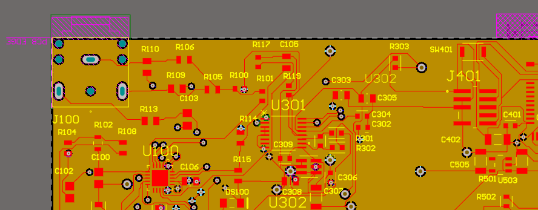
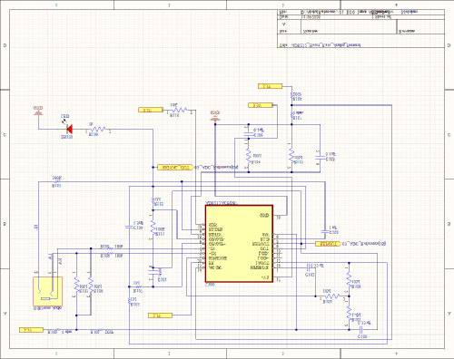
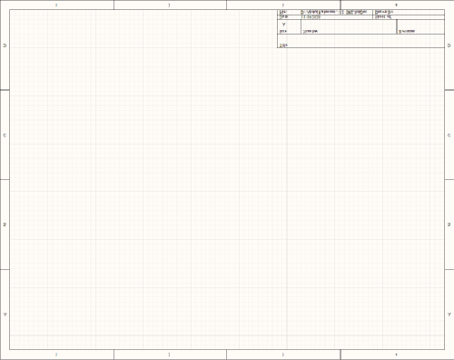
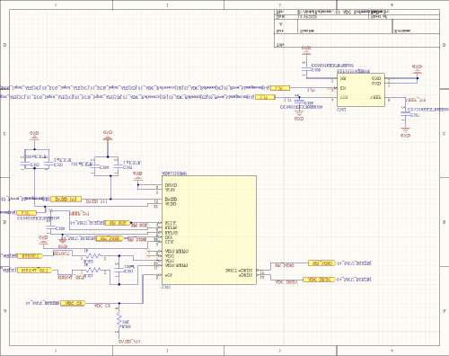
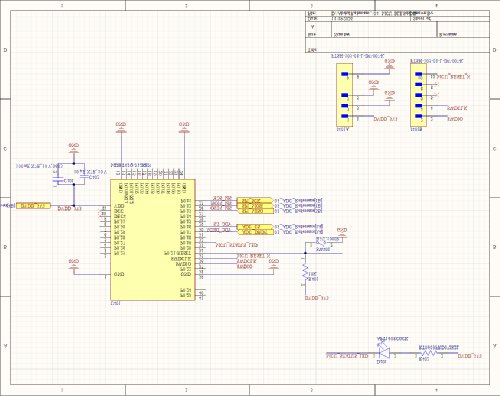
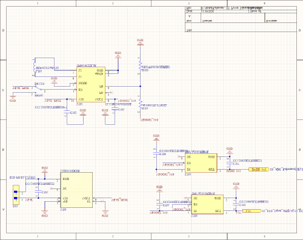

# Battery-Powered Wearable ECG Signal Acquisition Device



**University of Moratuwa · BM3110 / EN3533 Electronic Instrumentation (2026)**  
**Designed by:** Mokshan (230108U) and Abdul (230507R)  
**ECAD:** Altium Designer 26 · **Project status:** PCB designed, not medically validated.

> **Archive provenance:** The files in this repository were extracted from an earlier uploaded submission ZIP (`230108U_230507R_Assignment_2.zip`). This is **not confirmed** to be the latest, corrected local submission `230507R_230108U_Assignment_2.zip`. Replace native sources and rerun DRC on the final PCB revision before treating this as a released design.

## Overview

This educational project designs a battery-powered, single-lead wearable ECG acquisition board. The electrode interface and AD8232 condition small biopotential signals, an ADS1220 provides external delta-sigma conversion, and an nRF52832-based Raytac MDBT42Q module provides a Bluetooth Low Energy hardware interface. A driven-right-leg (DRL) stage addresses common-mode pickup. The analog and digital sections use separately regulated supplies.



## Actual PCB and schematic previews

**PCB editor screenshot (cropped from a user-provided Altium screenshot, not a manufactured-board photograph):**



**Schematic sheet previews embedded in the archived Altium files:**

| Sheet | Preview |
|---|---|
| ECG input and AFE |  |
| Driven-right-leg |  |
| ADC and reference |  |
| BLE microcontroller |  |
| Power management |  |

`06_System_Overview.SchDoc` is present as an editable source, but its archived preview was unavailable. These previews may not show every detail at reading resolution; open the native `.SchDoc` documents in Altium for inspection.

## Design blocks and component selection

The following designators and selected components are verified against the included BOM:

| Block | Component | Why it was selected |
|---|---|---|
| ECG analog front end | **AD8232ACPZ-R7** (`U100`) | Dedicated biopotential conditioning IC with high common-mode-rejection-oriented signal chain, suitable for low-amplitude ECG acquisition. Gain, high-/low-pass filtering and electrode bias arrangements must be reviewed using the complete schematic and datasheet. |
| Precision ADC | **ADS1220IPW** (`U301`) | External 24-bit delta-sigma ADC with SPI interface, allowing the sensitive conversion stage to be physically separated from wireless digital activity. Effective noise performance depends on configuration, bandwidth and reference. |
| ADC voltage reference | **REF35250QDBVR** (`U302`) | Dedicated nominal **2.5 V** reference, reducing direct dependence on digital-rail variations. Reference filtering, noise and local decoupling are essential. |
| BLE microcontroller module | **Raytac MDBT42Q-512KEN** (`U401`) | Compact nRF52832 BLE module; reduces RF implementation complexity but demands manufacturer-specified antenna clearance and suitable firmware. |
| Reverse-current/power-path element | **LM66100DCKR** (`U501`) | Ideal-diode/power-path blocking stage for battery current management. This IC **does not replace** a full charging or battery-protection subsystem. |
| Buck-boost | **TPS63802DLAR** (`U502`) | Maintains an intermediate supply when Li-ion cell voltage passes above/below the required voltage. |
| Analog and digital LDOs | **TPS7A2033PDBVR** (`U503`, `U504`) | Separate nominal 3.3 V regulation for the sensitive analog and noisy digital domains. Verify dropout margin at worst-case loading and tolerances. |

**Buck-boost setpoint:** BOM values `R501=562 kΩ` and `R502=91 kΩ` give `VBOOST ≈ 0.5(1+562/91) = 3.59 V` for the intended feedback topology and nominal 0.5 V reference. This calculation does not by itself establish adequate regulator headroom under load.

**Additional BOM details:** The PCB includes a 3.5-mm electrode jack (`J100`), a battery connector (`J501`), debug/programming header (`J401`), power inductor (`L501`, 470 nH), LED indicators and switching controls. The archived BOM marks `R101` and `R119` as DNP.

## Grounding, power and noise-aware PCB layout

- **Four-layer design:** top copper, `L2_GND` reference, `L3_POWER`, bottom copper; nominal intended thickness **1.6 mm**.
- **Continuous ground reference:** intended L2 ground plane rather than an unnecessary split; analog and digital circuits are spatially partitioned to control return-current paths.
- **Separate supplies:** analog `3.3V` and digital `DVDD_3V3` from distinct TPS7A2033 regulators, with `VBOOST_3V6` as their intermediate source.
- **Low-noise acquisition:** short sensitive input paths, local bypass capacitors, careful ADC reference return, separation from switching converters/SPI/BLE RF, and small high-current switching loops.
- **Antenna clearance:** the Raytac antenna region needs a manufacturer-defined copper/component keepout on all applicable layers; the visual screenshot alone does not prove compliance.

## Schematic files

The archive contains six sheets under `hardware/altium/`:

1. `01_ECG_Input_AFE.SchDoc`
2. `02_DRL.SchDoc`
3. `03_ADC_Reference.SchDoc`
4. `04_MCU_BLE.SchDoc`
5. `05_Power_Management.SchDoc`
6. `06_System_Overview.SchDoc`

The same folder contains the archived PCB `Wearable_ECG_230108U_230507R.PcbDoc` and project `Wearable_ECG_OptionA.PrjPcb`.

## Verification and limitations

An archived Altium DRC dated **2026-11-19 00:08:52** records **0 reported rule violations** including clearance, shorts, and unrouted nets. **The report explicitly references the earlier `Wearable_ECG_OptionA.PcbDoc` on the author's original C: drive**, not the subsequently renamed PCB. It must not be represented as verification of the current final revision without a rerun. Reports and BOM are under `docs/reports/`.

**Known portability issues in this archive:** the `.PrjPcb` contains absolute Windows source paths for several documents and references `Imported_Mokshan/PCB_Project/PcbLib1.PcbLib` and `Schlib1.SchLib`, which are missing from this uploaded archive. The actual external STEP dependencies have not been verified. Preserve the original source, repair the project-relative references in an Altium working copy, collect the used libraries and models, and validate before release.

**Still unverified:** current schematic-to-PCB synchronization, DRC of the final renamed design, resistor/RC transfer functions and analog safety, DRL stability/patient current limiting, firmware, actual BLE reception, and hardware fabrication/testing. No fabricated PCB or live ECG measurements are claimed.

## Repository layout

```text
hardware/altium/             Native archived Altium project, PCB and six schematics
docs/images/architecture.svg System architecture illustration
docs/images/pcb/            Cropped Altium PCB editor screenshot
docs/images/schematics/     Five native schematic previews
docs/reports/               BOM and archived DRC report
README.md                   Technical project documentation
.gitignore                  Excludes local Altium caches and backup artifacts
RELEASE_CHECKLIST.md        Final release and portability checks
```

## Opening the PCB

Open `hardware/altium/Wearable_ECG_OptionA.PrjPcb` with Altium Designer 26. The archived project contains stale absolute paths, so re-add the local `.SchDoc` and `.PcbDoc` documents to a saved project copy if needed. Resolve library references, inspect the PCB in 3D, compile the project and run a fresh DRC. Do not assume that opening a standalone PCB proves the project is portable.

## Safety

**Academic prototype only — not a medical device or a clinical diagnostic instrument.** Do not connect this electrode-facing prototype to a person while it is connected to non-isolated mains-powered USB, a debugger, a bench oscilloscope, or a charger. Proper isolation, leakage-current protection, DRL evaluation and applicable medical electrical-safety engineering are required before any patient-connected use.

## Acknowledgements

Developed by Mokshan and Abdul as an Electronic Instrumentation PCB design assignment at the University of Moratuwa.
